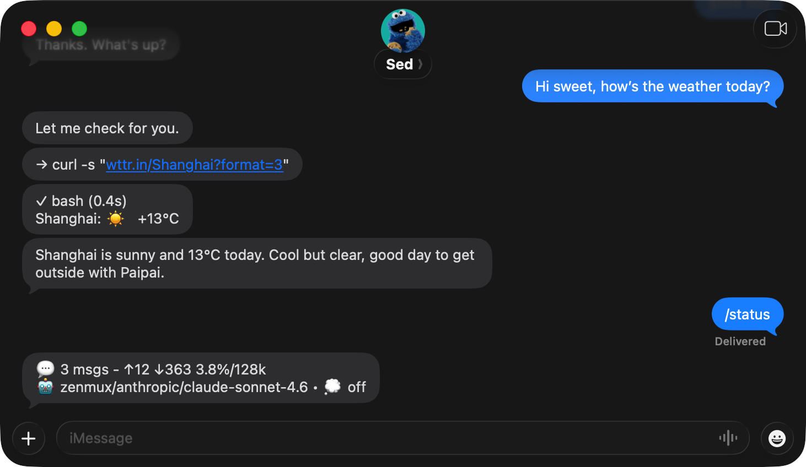

# pi-imessage

A minimal, self-managing iMessage bot powered by [Pi Durable](https://github.com/earendil-works/pi/tree/main/packages/durable).



## Features

- **Minimal**: No BlueBubbles or webhook setup. Runs directly on your Mac alongside Messages.app.
- **Messages**: DMs, SMS, and group chats, with sender identification and reply context.
- **Self-managing**: The agent builds its own tools, with native web search, page fetch, and a [conversation-owned browser](docs/browser.md).
- **Web UI**: Chat history, native task state, scheduled jobs with their latest ten executions, logs, memory, and configuration.
- **Memory**: Searchable, traceable records; corrections preserve history. See [structured memory](docs/memory.md).

## Quick Start

> Just point your Pi coding agent at this README and ask it to set up pi-imessage.

Prerequisites: macOS with Messages.app, Node.js 22.22.2 or newer, Python 3
(shared memory writer), Full Disk Access for the terminal, and an authenticated
[Pi Coding Agent](https://github.com/badlogic/pi-mono/tree/main/packages/coding-agent#quick-start).

```bash
npm install -g @kingcrab/pi-imessage

pi-imessage             # run in foreground
pi-imessage install     # write a launchd job; loading it is a separate operator action
```

Enable replies for your chats by adding their GUIDs to the [settings allowlist](#settings).
For installation and service operations, see [ops/README.md](ops/README.md).

## Commands

Send `/help` in a chat to list commands: `/new`, `/status`, `/thinking`,
`/compact`, `/run`, `/stop` and `/reload`.

## Configuration

### Settings

Edit `WORKING_DIR/settings.json`. All fields are optional.

```json
{
  "chatAllowlist": {
    "whitelist": ["iMessage;-;+11234567890"],
    "blacklist": ["*"]
  },
  "richText": {
    "enabled": false,
    "markdown": true
  }
}
```

### Workspace extensions

Personal tools, tasks and schedules live in `WORKING_DIR/extensions/<name>/`.
Startup, `/reload` and the assistant's `reload_extensions` load them. See
[workspace extensions](docs/workspace-extensions.md) for the factory contract
and scheduling rules.

### Model policy

Optional `settings.json` fields, applied at startup and `/reload`:

```json
{
  "modelPolicy": {
    "fallback": { "provider": "your-provider", "modelId": "your-model" },
    "codexServiceTier": "default"
  }
}
```

Without a fallback, an unavailable default fails explicitly. `codexServiceTier`
accepts `default` or `priority`; priority may have a different cost.

### Environment Variables

All variables are optional.

| Variable | Default | Description |
|---|---|---|
| `WEB_ENABLED` | `true` | Set to `false` to disable the built-in web UI |
| `WEB_HOST` | `localhost` | Web UI host |
| `WEB_PORT` | `7750` | Web UI port |
| `WORKING_DIR` | `~/.pi/imessage` | Workspace directory |

### Web and API

See the [HTTP API](docs/api.md) for read-only state and model health checks.
The agent sends files and extra messages with `send_message`.

## How It Works

```text
Messages chat.db → Watcher → Pi Durable → Messages.app
```

Each chat has its own conversation, persisted under `WORKING_DIR/durable/`.
Durable resumes pending work after a crash. Replies are sent at most once;
uncertain sends are flagged, never resent. Context is compacted silently every
six hours and near the model's limit.

## Layout

This repository is the framework; `WORKING_DIR` is one deployment's data and code.
See [workspace extensions](docs/workspace-extensions.md), ADR 0036 and ADR 0042.

```text
pi-imessage/                      framework, shared by every deployment
├── src/
│   ├── main.ts, cli.ts           startup, wiring, launchd install
│   ├── web/                      read-only HTTP API and pages
│   ├── agent/                    Durable harness, models, prompt, delivery, scheduler
│   ├── extensions/               built-in tools, workspace extension loader
│   ├── transport/                chat.db polling, Messages.app sending
│   └── config/                   settings, environment, chat allowlist
├── docs/                         architecture and ADRs (the design ground truth)
├── examples/workspace-extensions/ reference extensions to copy into a workspace
├── ops/                          deployment, preflight and smoke scripts
└── test/

WORKING_DIR/  (default ~/.pi/imessage)   one deployment, back it up yourself
├── settings.json                 chat allowlist, model policy
├── extensions/<name>/            personal tools, tasks and schedules
├── skills/file-memory/           structured memory store and core summary
├── durable/                      conversation state; never edit by hand
├── attachments/                  archived incoming files
└── service.log
```

## Development

See [AGENTS.md](AGENTS.md) for development rules,
[architecture](docs/architecture.md) for the module layout and execution flow,
and [ADRs](docs/adr/) for design decisions.
